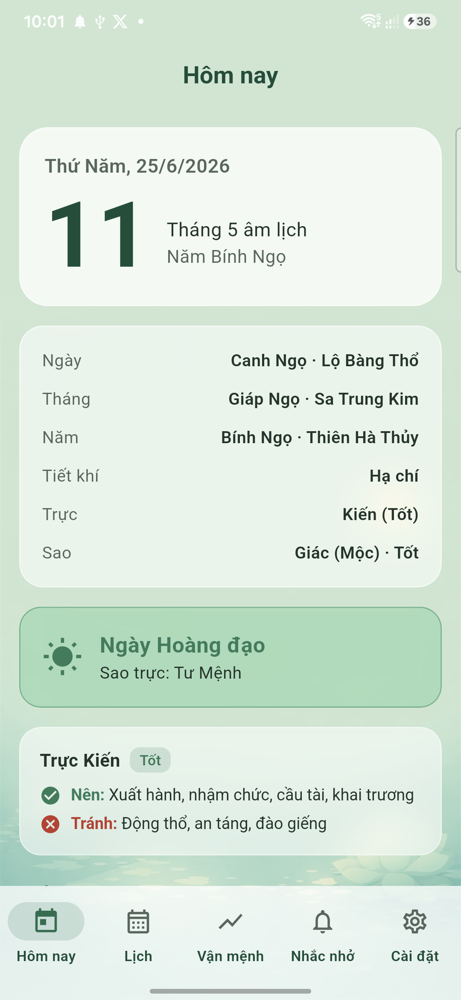
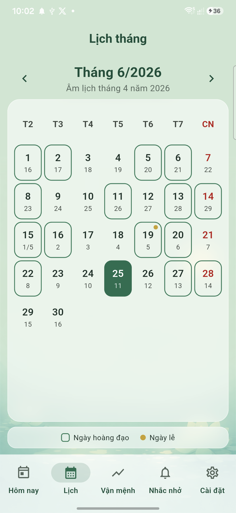
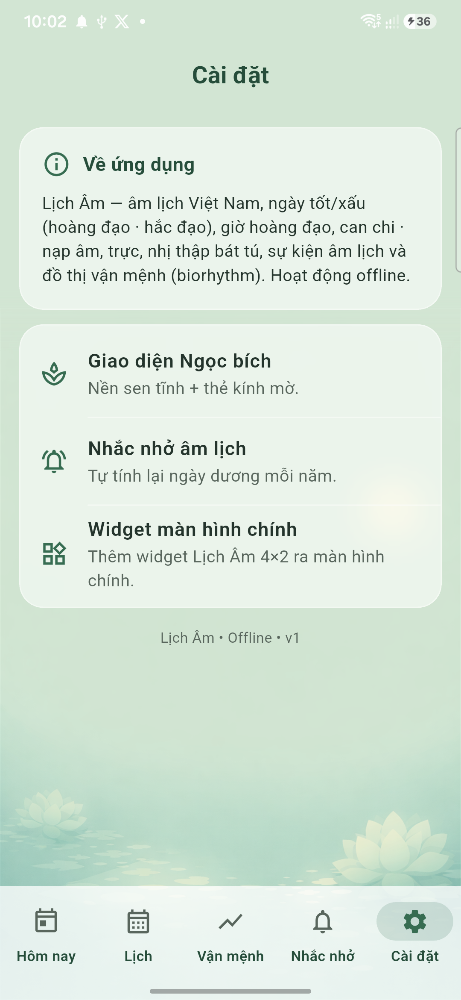
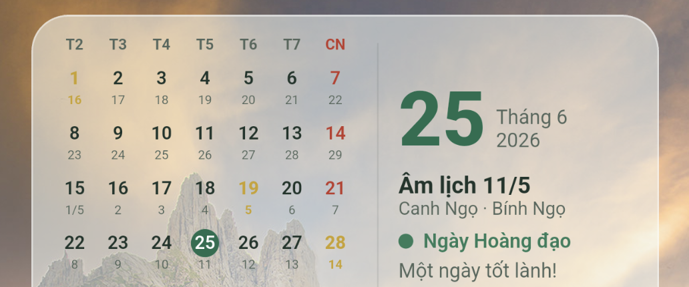

# 📅 An Lịch — Lịch Âm, Tử Vi & Phong Thủy

Ứng dụng Android **chạy hoàn toàn offline** cho người Việt: xem âm lịch, can chi, tiết khí,
ngày/giờ hoàng đạo, **xem ngày tốt – xem tuổi – phong thủy bát trạch**, **tử vi đẩu số** (an sao
12 cung + luận giải), **báo cáo vận trình xuất PDF**, biểu đồ sức khỏe và nhắc nhở sự kiện.
Giao diện kính mờ (glassmorphism) với **7 hình nền** và chế độ **Sáng / Tối / theo hệ thống**.

> **Không quảng cáo · Không thu thập dữ liệu · Không cần mạng.** Mọi tính năng là thuật toán / nội
> dung dựng sẵn chạy cục bộ trên máy. Lõi âm lịch dùng giải thuật thiên văn của **PGS. Hồ Ngọc Đức**
> (chuẩn de-facto cho lịch Việt, kinh tuyến 105°Đ — UTC+7), được **port trực tiếp** vào Dart và kiểm thử bằng unit test.

- **Nền tảng:** Android (Flutter) · **App ID:** `com.goccuameo.lich_am`
- **Phân phối:** APK cài trực tiếp, chia sẻ cho gia đình/bạn bè (không cần Play Store)

---

## 📸 Giao diện

<table>
  <tr>
    <td align="center"><br/><b>Hôm nay</b></td>
    <td align="center"><br/><b>Lịch tháng</b></td>
    <td align="center"><br/><b>Cài đặt</b></td>
  </tr>
</table>

*(Ảnh chụp thật từ Samsung Galaxy S24+.)*

### 🧩 Widget màn hình chính



Widget 4×2: **mini-lịch tháng** (mỗi ô có số dương to + số âm nhỏ), tô đậm hôm nay (vòng **xanh ngọc**),
Chủ nhật (đỏ), **ngày lễ (chữ vàng)**; kèm panel ngày dương + âm lịch + can chi + hoàng đạo + sự kiện.
Nền **bán trong suốt** để lọt hình nền điện thoại. **Tự đổi ngày** lúc nửa đêm (AlarmManager + render sẵn nhiều ngày, hoạt động cả sau khi khởi động lại máy).

---

## ✨ Tính năng

### 🗓️ Lịch & sự kiện
| Nhóm | Chi tiết |
|------|----------|
| **Âm lịch** | Chuyển đổi dương ↔ âm (UTC+7), nhận biết tháng nhuận; can chi ngày/tháng/năm; nạp âm 60 hoa giáp; 24 tiết khí |
| **Hoàng đạo / Trạch nhật** | Ngày & giờ hoàng đạo/hắc đạo, 12 Trực + Nhị thập bát tú, gợi ý Nên làm / Nên tránh, cảnh báo **ngày xấu** (Tam Nương, Nguyệt Kỵ, Dương Công Kỵ, Sát Chủ) |
| **Sự kiện** | Lễ âm lịch (Tết, Đoan Ngọ, Vu Lan, Trung Thu, Ông Táo…) + ngày kỷ niệm dương lịch, gộp "Sự kiện sắp tới" kèm đếm ngược |
| **Ngày này trong lịch sử** | Danh nhân VN + quốc tế sinh đúng ngày (ngày sinh đã tra cứu, không bịa) |
| **Lịch tháng** | Lưới âm-dương, chạm ngày → chi tiết hiện gọn ngay bên dưới |
| **Nhắc nhở** | Lặp hằng năm/tháng/một lần, theo âm/dương lịch, nhắc trước N ngày / mỗi ngày |
| **Sức khỏe (Biorhythm)** | 3 chu kỳ thể chất/cảm xúc/trí tuệ, biểu đồ cuộn theo năm/tháng + vạch "Nay" + giải thích |

### 🔮 Tiện ích Tử vi – Phong thủy (tab "Tiện ích")
| Công cụ | Chi tiết |
|---------|----------|
| **Xem ngày tốt** | Chọn việc (cưới hỏi, động thổ, khai trương…) → quét & xếp hạng ngày trong 30/60/90 ngày |
| **Hướng xuất hành** | Hỷ Thần / Tài Thần theo can ngày + giờ Lý Thuần Phong (Lục diệu) |
| **Xem tuổi làm nhà** | Kim Lâu, Hoang Ốc, Tam Tai + Tam hợp / Tứ hành xung |
| **Hợp tuổi** | Hợp tuổi vợ chồng + tuổi xông đất đầu năm |
| **Phong thủy bát trạch** | Cung phi (Đông/Tây tứ mệnh), 8 hướng tốt/xấu, màu hợp mệnh + **la bàn động** (cảm biến) |
| **Cúng lễ** | Văn khấn theo dịp (màn hình **không tắt** khi đọc), ngày vía, lịch ăn chay (thập trai) |
| **Sao hạn & Thần số** | Sao chiếu mệnh Cửu diệu theo năm + số chủ đạo thần số học |
| **Tử vi đẩu số** | **An sao đầy đủ 12 cung** (port `lasotuvi` MIT, khớp tuyệt đối các lá số chuẩn), luận giải **2 chế độ**: *Cơ bản* (đời thường, như một bản phân tích tính cách) và *Chuyên sâu* (đầy đủ thuật ngữ, sao hỗ trợ/sát tinh, bộ sao, cách cục); chấm theo chủ đề, tổng kết, vận hạn năm; **nhập giờ sinh 3 trạng thái** (chính xác / ước lượng / không biết) kèm cảnh báo độ tin cậy |
| **Hồ sơ vận trình** | Báo cáo tử vi cá nhân dạng đọc (tính cách, sự nghiệp, tài chính, tình duyên, sức khỏe, con cái, phúc đức, tổng kết, vận hạn) + **xuất PDF** (font tiếng Việt nhúng sẵn, offline) |
| **Góc kiến thức · Đổi ngày · Tính tuổi** | Bài phong thủy, đổi ngày Dương↔Âm bất kỳ, tính tuổi / khoảng cách ngày |

### 🎨 Trải nghiệm
- **7 giao diện** (Ngọc bích, Sen ngọc, Hoàng kim, Bạch ngọc, Dạ nguyệt, Tử Vân, Hồng Vân) + chế độ **Sáng / Tối / theo hệ thống**, **cỡ chữ** to cho người lớn tuổi.
- **Splash + hướng dẫn (onboarding)** lần đầu; chuyển cảnh mượt.
- **Chia sẻ ảnh "hôm nay"** ra Zalo/Facebook; **Sao lưu / khôi phục** toàn bộ dữ liệu ra tệp `.json`.
- **Widget** màn hình chính tự đổi ngày.

> ⚠️ Nội dung tử vi / phong thủy / xem ngày mang tính **tham khảo, tín ngưỡng dân gian**, không phải khẳng định khoa học hay dự đoán chắc chắn về tương lai.

---

## 🏗️ Công nghệ & kiến trúc

- **Flutter 3.44 / Dart 3.12**, Material 3, locale tiếng Việt. Lõi tính toán tách khỏi UI → kiểm thử độc lập.
- **6 tab**: Hôm nay · Lịch · Tiện ích · Sức khỏe · Nhắc nhở · Cài đặt.

```
lib/
├── core/                     # thuật toán thuần (test được)
│   ├── lunar_calendar.dart · can_chi.dart · nap_am.dart · hoang_dao.dart · truc_tu.dart
│   ├── lunar_events.dart · solar_events.dart · historical_figures.dart · biorhythm.dart
│   ├── ngay_xau.dart · xuat_hanh.dart · trach_nhat.dart · xem_tuoi.dart · hop_tuoi.dart
│   ├── bat_trach.dart · sao_han.dart · than_so.dart · van_khan.dart · ngay_via.dart
│   ├── tu_vi.dart            # engine an sao 12 cung (port lasotuvi)
│   ├── tu_vi_dien_giai.dart · tu_vi_tong_hop.dart · tu_vi_data/  # luận giải 2 chế độ
│   └── bao_cao_tu_vi.dart    # tổng hợp báo cáo "Hồ sơ vận trình"
├── data/                     # profile_store · reminder_store · settings_store · backup_service
├── services/                 # notifications · widget_service · share_service · bao_cao_pdf (xuất PDF)
└── ui/                       # splash · onboarding · home_shell · today · month · tien_ich (hub)
                              # tu_vi · bao_cao · ho_so · bat_trach · la_ban · cung_le · … + theme, patterns/, widgets/
```

### Thư viện chính
`pdf` · `printing` · `fl_chart` · `flutter_local_notifications` · `home_widget` · `share_plus` ·
`screenshot` · `file_selector` · `wakelock_plus` · `flutter_compass` · `path_provider` · `timezone` ·
`shared_preferences` · `intl` · `flutter_localizations`

---

## 🚀 Build & chạy

> Yêu cầu: Flutter SDK + Android SDK (API 35/36) + JDK 17.

```bash
flutter pub get
flutter test                 # 174 unit test cho phần lõi
flutter analyze

# Bản chia sẻ cho máy thật (arm64, nhẹ ~22 MB)
flutter build apk --release --split-per-abi --target-platform android-arm64
# -> build/app/outputs/flutter-apk/app-arm64-v8a-release.apk
```

## 📲 Cài lên điện thoại

Bật **Developer options → USB debugging** trên máy, cắm USB (chế độ **Truyền tệp**) rồi bấm **Allow**.

```bash
adb devices      # phải thấy máy ở trạng thái "device"
adb install -r build/app/outputs/flutter-apk/app-arm64-v8a-release.apk   # -r: cài đè, giữ dữ liệu
```

> - `unauthorized` → nhìn màn hình điện thoại bấm **Allow** rồi chạy lại.
> - `INSTALL_FAILED_VERSION_DOWNGRADE` → thêm cờ `-d`.
> - Build release cần `android/key.properties` + keystore của riêng bạn (không kèm trong repo).

> **Samsung One UI:** nếu nhắc nhở không kêu, vào **Settings → Apps → An Lịch → Battery → Unrestricted**.

---

## 🎯 Độ chính xác & kiểm thử

- **174 unit test** cho phần lõi, gồm: Tết 2024/2025/**2026 (17/02)**, round-trip dương↔âm, can chi năm,
  tiết khí, giờ hoàng đạo; **tử vi đẩu số khớp tuyệt đối 3 lá số chuẩn**; các luật xem ngày / xem tuổi /
  bát trạch đối chiếu nguồn phổ biến.
- **Lưu ý:** nội dung tử vi / phong thủy dùng luật cổ truyền phổ biến (nhiều dị bản) — mang tính tham khảo.

---

## 📝 Giấy phép & ghi nhận

- Giải thuật âm lịch: **PGS. Hồ Ngọc Đức** — *Lịch Việt Nam* (thuật toán công khai).
- Engine an sao tử vi: port từ **`doanguyen/lasotuvi`** (MIT).
- App dùng cho mục đích cá nhân / chia sẻ phi thương mại.
